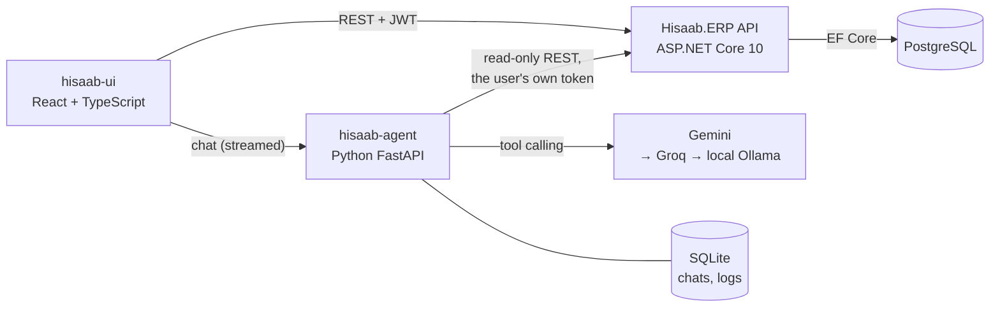

# Hisaab: AI-Powered ERP for Flour Mills

Hisaab is a complete ERP for flour mills in Pakistan, with an AI assistant that answers business questions in English,
Urdu and Roman Urdu from the mill's own live data.

It runs the whole mill in one system: buying wheat, receiving trucks at the gate and weighbridge, quality checks,
milling with automatic yield, packing, stock by warehouse and lot, sales orders and dispatch, invoices, payments,
receivables and reports. Every role sees only its own part of the business.

> "Is mahine kitni sale hui?" → *"Is mahine total sales PKR 13,942,485 hai. Sab se zyada bikne wala product
> Chakki Atta 20 kg hai..."*, with the full invoice table underneath.

---

## How it fits together



Three parts, each in its own folder:

| Folder | What it is | Stack |
|---|---|---|
| `CrescentFlourMill/hisaab-ai/` | The ERP API: business rules, stock ledger, permissions | ASP.NET Core 10, Entity Framework Core 8, PostgreSQL |
| `hisaab-ui/` | The web app for every role | React 19, TypeScript, Vite, Material UI |
| `hisaab-agent/` | The AI assistant service | Python, FastAPI, Gemini / Groq / Ollama, SQLite |
| `scripts/` | End-to-end workflow test, demo data generator, deploy helper | Node.js, Bash |

---

## The ERP

### The mill's workflow


Every step that moves stock writes to a **stock ledger**, so any lot's balance can be traced back move by move, and
the stock report always reconciles with what is on hand.

### Modules

- **Purchasing:** purchase orders to suppliers, draft → sent → received or closed short.
- **Receiving:** gate entry, weighbridge (net = gross − tare), QC approve or reject, goods received into a warehouse
  and lot; packaging is counted instead of weighed. A 5% weighbridge tolerance over the ordered quantity.
- **Production:** milling batches consume wheat lots and produce flour products, bran and waste. Output plus waste
  must equal input before a batch can be completed; yield is calculated automatically. Outputs are quality-approved,
  then packed from bulk kg into bags, using up empty-bag stock.
- **Inventory:** stock by product, warehouse, bin and lot, in bulk kg or packed bags, with the full movement history.
- **Sales:** sales orders, dispatch in one or more trucks, invoices that bill what was actually dispatched, payments
  by cash, bank transfer or cheque, and credit-limit warnings.
- **Dashboard:** sales, receivables, stock, milling and yield at a glance, plus a "needs attention" list: overdue
  invoices, customers over their credit limit, trucks waiting for QC, batches still open.
- **Reports:** sales, receivables ageing, stock movement and production, exportable to CSV, Excel and PowerPoint, and
  printable invoices.

### Roles

| Role | Sees and does |
|---|---|
| Owner | Everything, including the AI assistant |
| Admin | Everything, plus user accounts |
| Operations | Purchasing, receiving, production, stock |
| Sales | Customers, sales orders, invoices, payments |
| Worker | Receiving, production, stock |

The rules are enforced by the API, not only hidden in the UI. A token stops working as soon as its user is
deactivated or their role or password changes.

### Built to stay correct and fast

- **No lost updates:** every write runs in one transaction behind a database lock, so two people dispatching the
  same stock at the same moment can never both succeed.
- **Document numbers** (PO-2026-001, INV-2026-154 ...) come from database sequences, so they never repeat.
- **History is kept:** mistakes are corrected by reversing entries, not by deleting them.
- **Speed:** growing lists are paged and searched on the server (25 rows a page), the dashboard is cached until the next
  change, responses are compressed, and the date columns used by filters are indexed.

---

## The AI assistant

The assistant answers questions like *"Which customers owe us the most money?"*, *"Gandum ka stock kitna hai?"* or
*"Make this month's sales report in Excel"*, using live ERP data.

### How a question is answered

1. The user's question goes to the assistant service with their sign-in token.
2. The model reads the question and picks one or more **tools**, for example `receivables` for "who owes us money".
3. The tool calls the ERP API **with the user's own token**, so the assistant can only see what that user's role is
   allowed to see. Tools only read (GET); the assistant cannot create, change or delete anything.
4. The model writes a short answer from the tool's result, streamed word by word, in the language of the question.
5. The app shows the full table the tool read under the answer, and a download card if a report file was made.

### Tools

| Tool | Answers |
|---|---|
| `business_overview` | Today's snapshot: wheat and flour stock, milling, yield, sales, receivables |
| `receivables` | Who owes money, overdue invoices, ageing (not due, 1-30, 31-60, 61+ days) |
| `sales_report` | Sales for a period, by customer and by product |
| `current_stock` | Stock on hand by product, warehouse and lot |
| `stock_movement_report` | Opening, received, produced, used, dispatched and closing stock for a period |
| `production_report` | Completed batches, input, output and yield for a period |
| `supplier_quality` | QC pass rate, moisture and impurities per wheat supplier |
| `purchase_orders` | Open and expected deliveries, ordered vs received |
| `sales_orders` | Customer orders, ordered vs dispatched |
| `customer_details` | Credit limits and outstanding balances |
| `create_report` | A downloadable Excel or PowerPoint report |

### Guard rails

- **No invented numbers.** An answer with figures but no tool call is never shown; the model is told to look the data
  up first. Filters the user never typed (a customer name the model made up) are dropped.
- **Two-part questions** ("expected deliveries today and who owes us money") are split and each part is looked up.
- **Privacy:** phone numbers, contact persons and addresses are removed before anything is sent to the AI provider;
  the user still sees them in the table in the app.
- **Reliability:** Gemini answers first. If it is rate-limited, failing or sends nothing within 8 seconds, the
  question goes to Groq, and then to a local Ollama model if one is configured. A provider that keeps failing is
  skipped for a minute.
- **Usage log:** every question records the provider, whether a fallback was needed, tokens, estimated cost, timings
  and the tools used. Owners and admins see it on the assistant's Usage page, along with thumbs up and down from users.

---

## Demo mode

With `Demo__Enabled=true` the API runs as a public demo:

- It loads 75 days of generated mill activity (`CrescentFlourMill/hisaab-ai/Demo/seed.sql`) and reloads it once a day,
  moving every date forward so the dashboard always shows today's activity.
- Visitors sign in with one click as any role; there are no passwords.
- Changes to user accounts and passwords are blocked, so one visitor cannot lock out the others.

The sample data is fictional. It is generated through the real API by `scripts/demo-data/generate.cjs`, so stock,
balances and document numbers are all consistent.

---

## Running it locally

You need the .NET 10 SDK, Node.js 20+, Python 3.12+, and PostgreSQL 15+ (or Docker).

**1. Database**

```bash
docker run -d --name hisaab-pg -e POSTGRES_PASSWORD=postgres -p 5432:5432 postgres:17
```

**2. ERP API** (port 5069; creates the database tables on start)

```bash
cd CrescentFlourMill/hisaab-ai
cp appsettings.Development.example.json appsettings.Development.json   # set Jwt:Key and the demo users
dotnet run
```

**3. AI assistant** (port 5080)

```bash
cd hisaab-agent
python -m venv .venv
.venv/Scripts/python -m pip install -r requirements.txt   # .venv/bin/python on macOS and Linux
cp .env.example .env                                        # AGENT_JWT_KEY = the API's Jwt:Key, plus a Gemini key
.venv/Scripts/python -m uvicorn app.main:app --port 5080
```

**4. Web app** (port 5173)

```bash
cd hisaab-ui
cp .env.example .env.local
npm install
npm run dev
```

Keys and passwords only go in the git-ignored files (`appsettings.Development.json`, `.env`, `.env.local`).

## Tests

- `hisaab-agent`: `.venv/Scripts/python -m pytest` runs the assistant's 110 tests (tools, guard rails, fallback,
  privacy, reports, chat API).
- `scripts/verify-workflows.cjs` drives the whole business workflow through the API, from purchase order to payment,
  including concurrent writes and ledger reconciliation (268 checks). Run it against a separate test database; the
  instructions are at the top of the file.
- `hisaab-agent/eval/compare_providers.py` asks 30 English, Urdu and Roman Urdu questions to each AI provider and
  compares which tools they pick.
